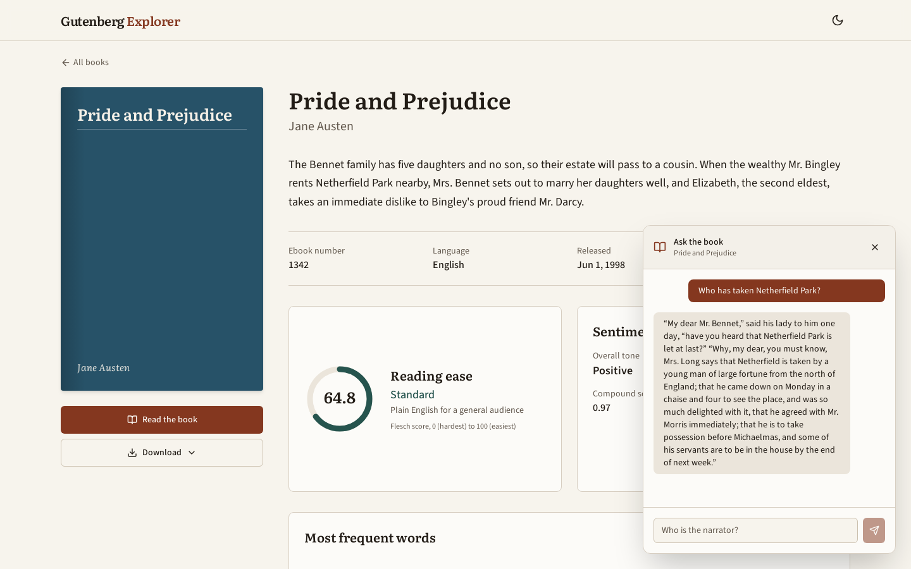
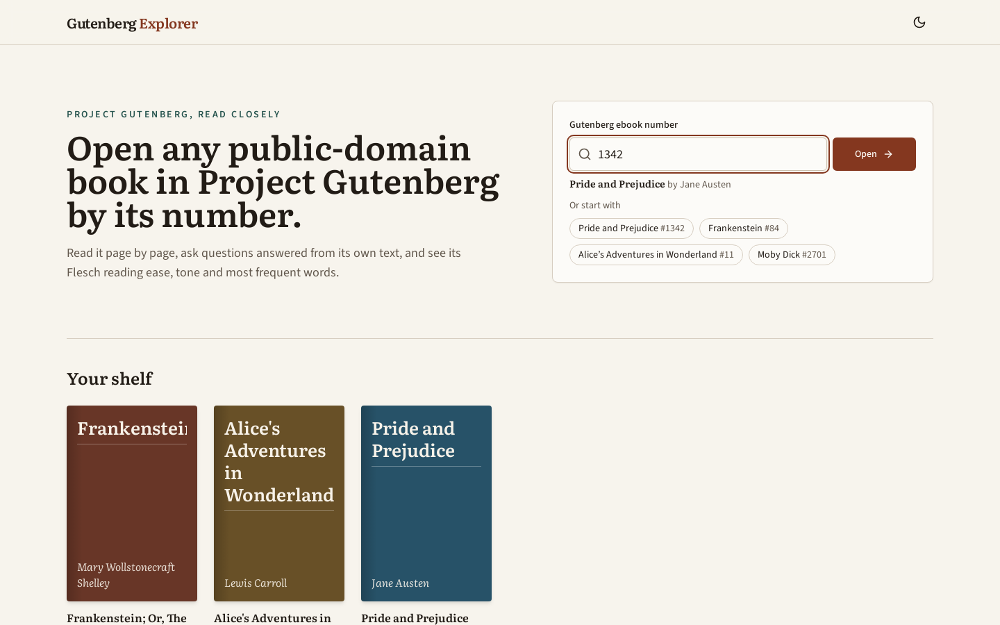
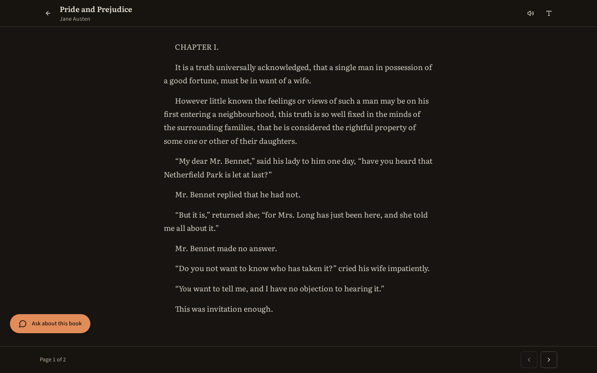
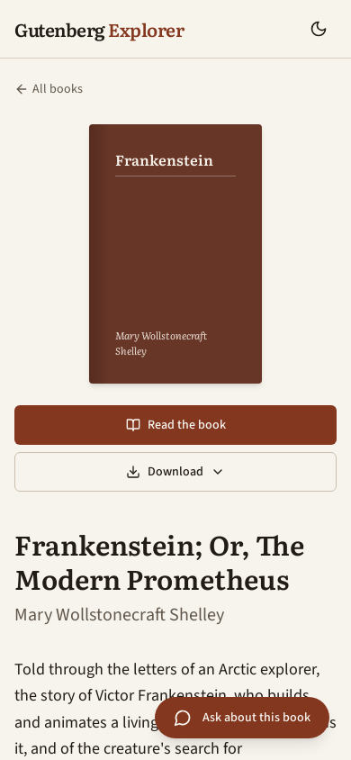
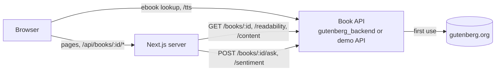

# Gutenberg Explorer

A reading room for Project Gutenberg. Open a public-domain book by its ebook
number, read it page by page, ask questions that are answered from the book's
own text, and see its Flesch reading ease, overall tone and most frequent
words.

This repository is the Next.js frontend. The book data, question answering,
readability and sentiment analysis come from a separate FastAPI service,
`gutenberg_backend`. That service answers questions extractively from the
text when no LLM key is configured. For trying the frontend on its own,
this repository includes an offline demo API that serves three bundled
public-domain books.


## Run it

### Offline demo (nothing else needed)

```bash
docker compose -f compose.demo.yml up --build
```

Open <http://localhost:3600/book/1342>. The demo API in `scripts/demo-api.mjs`
serves *Pride and Prejudice* (1342), *Frankenstein* (84) and *Alice's
Adventures in Wonderland* (11) from `fixtures/books/`. Their texts are short
excerpts, and their reading-ease, sentiment and word-count figures are
illustrative fixture values, not measurements. Any other number shows the
"no book with that number" page. Read-aloud is not available in the demo.

### With the real backend

Check out `gutenberg_backend` next to this repository, then:

```bash
docker compose up -d --build
```

This builds both services and opens the frontend on <http://localhost:3600>
and the API on <http://localhost:8600>. Without `GROQ_API_KEY` the backend
answers from the book's text. With it, the backend uses an LLM. The backend
downloads books from gutenberg.org on first use.

### Development

Node 22 (see `.nvmrc`):

```bash
npm ci
cp .env.example .env.local     # point it at a running API
npm run dev                    # http://localhost:3000
```

`node scripts/demo-api.mjs` starts the demo API on port 8000 if you have no
backend. Set both URLs in `.env.local` to `http://localhost:8000`.

| Command | What it does |
|---|---|
| `npm test` | Vitest suite (41 tests, no network) |
| `npm run lint` | `next lint` over app, components, lib and tests |
| `npm run typecheck` | `tsc --noEmit` |
| `npm run build` | Production build. Works offline because the fonts are self-hosted |

## What it does

| Page | |
|---|---|
| `/` | Look up a book by ebook number, with a live title preview. Starting points, and a shelf of the books you opened recently (kept in `localStorage`). |
| `/book/[id]` | Catalogue summary (or one generated from the text when the catalogue has none), facts, reading-ease dial, sentiment, word cloud, subjects, Gutenberg download links, and a question panel. |
| `/book/[id]/read` | Paged reader with font size and line spacing controls, read-aloud through the backend's `/tts`, and the question panel. |



| Home | Reader, dark theme | Mobile |
|---|---|---|
|  |  |  |

## How it fits together



Book pages are server components. They load the metadata, readability and
text on the server, so the reader never downloads a whole novel twice. The
three `/api/books/[id]/*` route handlers forward questions, summary requests
and sentiment to the backend, through `lib/backend.ts`:

```http
POST /api/books/1342/ask
{"query": "What news does Mrs. Bennet bring?"}

200 {"answer": "“My dear Mr. Bennet,” said his lady to him one day, “have you heard that Netherfield Park is let at last?” Mr. Bennet replied that he had not."}
```

```http
POST /api/books/1342/ask
{"query": ""}

400 {"error": "A question is required"}
```

```http
POST /api/books/999999/ask
{"query": "Anything?"}

404 {"error": "The book service could not answer", "details": "{\"detail\":\"Book not found\"}"}
```

These were captured from the demo stack. An unreachable backend gives `502`,
and so does a reply that contains no answer.

## Design notes

- **Two API URLs.** `NEXT_PUBLIC_API_BASE_URL` is inlined into the browser
  bundle at build time and must be the host-published port.
  `API_BASE_URL_SERVER` is read at runtime by the Next.js server. Inside
  Compose it is the service name, because `localhost` there is the frontend
  container itself. Both live in `lib/api.ts`.
- **A missing measurement stays missing.** A `null` reading-ease score shows
  as "Not measured for this book". Labels follow Flesch's own bands. An API
  failure shows an error page with a retry, never a placeholder book.
- **One sentiment request per page.** Each uncached request starts a
  full-text analysis on the backend, so `useSentiment` fetches once and feeds
  both panels. While the backend is still working it returns a neutral
  placeholder. The UI reports that as "running" with a *Check again* button
  rather than showing it as a result.
- **Questions time out.** The question panel gives up after 60 seconds. The
  first question on a book also indexes its text on the backend, which is
  slow.
- **Offline builds.** Literata (titles and reading text) and Source Sans 3
  (interface) come from `@fontsource`, so `next build` needs no network.
- **Untrusted HTML.** Book pages may contain HTML, and they are rendered
  through `rehype-sanitize`. Plain-text pages are reflowed, because
  Gutenberg hard-wraps its text at about 70 characters.

## Configuration

Copy `.env.example`:

| Variable | Default | Used by |
|---|---|---|
| `NEXT_PUBLIC_API_BASE_URL` | `http://localhost:8600` | Browser (build time) |
| `API_BASE_URL_SERVER` | value above | Next.js server (runtime) |
| `GROQ_API_KEY` | empty | Backend only, via `docker-compose.yml`. Empty means extractive answers |

## Limitations

- **Lookup is by ebook number only.** The backend's search endpoint returns
  an empty list, so the home page does not offer title search.
- **Subjects with commas split badly.** The backend joins Gutenberg subjects
  with `", "`. A subject such as "Frankenstein, Victor (Fictitious
  character) -- Fiction" therefore loses its first name.
- **Sentiment re-runs while processing.** The backend queues a new analysis
  for every uncached request, including *Check again*.
- **`react-wordcloud` is unmaintained.** It declares a pre-React-18 peer
  range, which is why `.npmrc` sets `legacy-peer-deps`, and it pulls in a
  `d3-color` version with a ReDoS advisory.
- **Next.js 14.** Next 14.2.35 is the last 14.x release. The remaining
  `npm audit` advisories for `next` are fixed only in 15/16, which needs a
  migration (async route params, React 19).

## License

MIT, see [LICENSE](LICENSE). Book texts are from Project Gutenberg and are in
the public domain in the United States.
