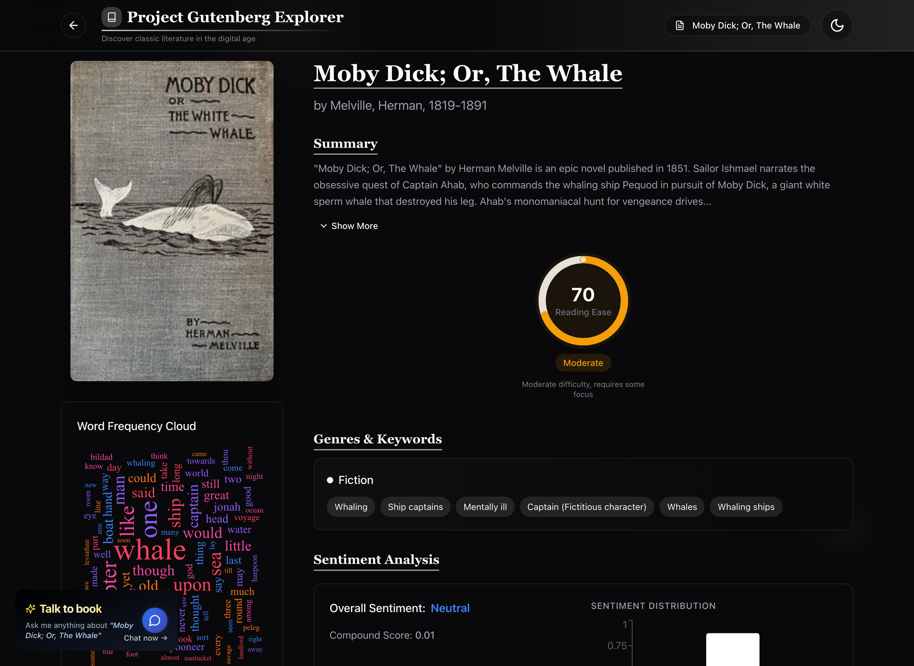

# Project Gutenberg Explorer

Browse 70,000 public-domain books, read them, ask questions about them, and see
how they score on sentiment and readability.

Next.js 14, Tailwind, shadcn/ui, with a [FastAPI backend](../gutenberg_backend).

**It runs with no API key.** Questions are answered from the book's own text
when no model is configured.

---

## Run it

```bash
docker compose up -d --build
```

This starts both the frontend and the API from `../gutenberg_backend`. Open
**http://localhost:3600**.



---

## The invented metric

The most serious thing found here. `BookDetails.tsx` contained:

```js
// Get consistent random score based on book ID if original score is null
const getConsistentRandomScore = () => {
  if (book.readingEaseScore !== null) return book.readingEaseScore

  let hashNum = 0
  for (let i = 0; i < book.id.length; i++) {
    hashNum += book.id.charCodeAt(i)
  }

  // Generate a score between 50 and 100
  return 50 + (hashNum % 51)
}
```

The backend never returned a reading-ease score, so **every book got a number
derived from the characters in its ID**, rendered in a dial and labelled "Easy"
or "Difficult". It was stable, it was plausible, and it measured nothing. A
reader had no way to tell it apart from a measurement.

It is now computed for real — Flesch Reading Ease over the book's text, in the
backend — and `null` renders as "Not measured for this book" rather than being
filled in.

```
Alice in Wonderland   78.9  Fairly easy
Moby Dick             69.5  Standard
Pride and Prejudice   64.8  Standard
Frankenstein          54.3  Fairly difficult
```

Getting that right took two corrections of its own, both in
[the backend README](../gutenberg_backend) — counting words and sentences over
the same span, and recognising sentences that end inside quotation marks.
Replacing a fabricated number with a wrong one would not have been an
improvement.

---

## The dead backend

Six components hardcoded this as their API fallback:

```js
process.env.NEXT_PUBLIC_API_BASE_URL || 'https://dull-meggie-1omar-d9f030db.koyeb.app'
```

That host no longer resolves. A fresh clone failed on every AI feature with a
network error pointing at someone else's expired free-tier deployment.

There is now one module that owns the question, and it distinguishes two cases
that are genuinely different:

```ts
export const API_BASE_URL = process.env.NEXT_PUBLIC_API_BASE_URL ?? "http://localhost:8600";
export const API_BASE_URL_SERVER = process.env.API_BASE_URL_SERVER ?? API_BASE_URL;
```

Next.js route handlers run **inside the container**, where `localhost` is the
frontend itself, not the API — server-side calls to the browser's URL fail with
`ECONNREFUSED`. The browser needs the published host port; the server needs the
compose service name.

---

## The dependency mess

```json
"day": "^0.0.2",
"picker": "^0.1.4",
```

Neither is imported anywhere. They are the signature of a mistyped install —
`npm install react day picker` instead of `react-day-picker`, which npm
happily obliged. Two obscure, unmaintained packages sat in the dependency tree
of a deployed application for no reason. `react-router-dom` was also installed
and never imported, in a Next.js app that has its own router.

The build script was:

```json
"build": "npm install react-day-picker@9.6.4 --no-save && next build"
```

Installing a package *during the build*, one already declared as a dependency
at that same version. It made every build network-dependent and
non-reproducible. The underlying problem was a peer conflict —
`react-wordcloud` pins a pre-React-18 range and is unmaintained — which is now
declared once in `.npmrc` where it can be seen and reasoned about.

---

## What else was fixed

- **`sharp` was missing**, which Next.js standalone mode requires for image
  optimisation; the server logged an error on every book cover.
- **"No word frequency data available"** was shown while the analysis was still
  running, which reads as a failure rather than progress. The backend reports
  `status: "processing"`, and the interface now says so.
- **There was no Dockerfile.**

---

## Layout

```
app/
├── page.tsx                  search and recently viewed
├── book/[id]/
│   ├── page.tsx              server component; fetches metadata + readability
│   └── BookDetails.tsx       the detail view
├── components/
│   ├── BookChat.tsx          ask questions about the book
│   ├── sentimentAnalysis.tsx sentiment + word cloud
│   └── TriggerBookEmbeddings.tsx
└── api/books/[id]/           route handlers proxying to the backend
lib/api.ts                    the one place that knows where the API is  ← added
```

## Configuration

| Variable | Default | Purpose |
|---|---|---|
| `NEXT_PUBLIC_API_BASE_URL` | `http://localhost:8600` | Build-time; used by the browser |
| `API_BASE_URL_SERVER` | same | Runtime; used by route handlers |
| `GROQ_API_KEY` | empty | Passed to the backend; absent ⇒ extractive answers |

## Known limitations

- **No frontend tests.** The backend has 37; this has none, and the bugs found
  here — a fabricated metric, a dead URL, phantom dependencies — are exactly
  the kind a test would not have caught anyway. A render test asserting that a
  null score shows "Not measured" would catch a regression of the worst one.
- **Sentiment analysis takes about a minute** on a full novel.
- **`react-wordcloud` is unmaintained** and pins an old React peer range. It
  works, but it is the reason `.npmrc` needs `legacy-peer-deps`.
- **Search hits gutenberg.org on every query** with no caching.
